# macOS ARM64 原生迁移验收

范围依据2026-10-30用户修订及ADR-0003：只验收本机macOS ARM64，Windows/Linux/macOS Intel不作本轮完成门槛，也不声称已通过。环境为macOS15.7.7 (24G720)、arm64，Go1.27.3、MyGo0.7.3。所有真实窗口操作使用临时--data-dir，未读写真实用户数据库、Skill目标或AGENTS.md。

## 已完成的功能流程

| 任务 | 真实窗口及文件观察 | 自动化补充 |
| --- | --- | --- |
| #2 原生样本 | 中文输入法nihao组合→Space提交“你好”，复制粘贴/撤销、手柄拖放、Tab/Space/Enter/Escape、焦点返回 | 持握拖拽边缘2秒自动滚动、组合输入及排序；历史样本记录见native-sample/validation |
| #3 片段持久化 | 新增中文片段默认禁用，启用后实际生成受管标记与正文 | 旧schema/主键、备份恢复、文件/SQL/COMMIT失败补偿 |
| #4 片段交互 | 搜索匹配项时手柄禁用，清空后实际拖到末尾；SQLite与生成文件均同步为第二条/第三条/原第一条 | 完整ID排序校验、搜索/筛选不改真实顺序、滚动/取消/异步浏览保护 |
| #5 Skills浏览 | 详情→关联指南，相对Markdown、右侧/底部；默认和最小窗口截图 | 旧JSON/catalog/项目数据迁移、稳定ID、路径越界/符号链接限制 |
| #6 全局开关 | 启用review立即增加统计，实际受管软链指向镜像；禁用后移除 | 同名隔离、手工对象保护、链接/数据库COMMIT失败恢复 |
| #7 安装/更新 | 受控fake npx安装keep/gone→启用两者→更新keep/new；keep保留启用，gone镜像与链接删除；失败原因可见且旧数据保留 | 真实子进程适配、受限PATH、恶意路径/循环、替换及COMMIT失败补偿 |
| #8 批量/删除 | 两来源全部更新成功1/失败1，显示失败对象；删除确认2Skills/0启用，取消后重开成功；其他链接和manual.txt保留 | 空库、混合结果、取消/失败/成功及完整回滚 |
| #9 MCP配置 | 新增stdio服务，快照更新；删除影响及Escape取消 | 三传输字段/校验、兼容字段保留、非法输入/失败保留草稿 |
| #10 stdio调试 | 本地协议fixture发现echo，中文JSON成功返回文本与耗时647ms | 30秒默认/短超时注入、非法参数/错误、父子进程组回收、切换服务拒绝旧结果 |
| #11 HTTP/SSE | 本机可控服务两个传输分别发现echo并调用中文JSON，各显示2ms；切换后旧结果清除，enabled=false记录可调试 | 真实协议、头占位符、超时、响应流/会话回收、跨来源头保护及敏感内容不进入错误 |
| #12 设置 | 五档字号逐一点击并保存默认/最小窗口截图；搜索选择PingFang SC，右侧50.6%，重启与SQLite确认恢复 | 旧设置键/JSON、原子保存、字体枚举/存储失败反馈、共享预览设置 |

Skills下载使用本地可控fake npx进程，**没有声称真实公网下载已经执行**；正式安装仍依赖Node/npx。MCP使用本地真实协议fixture，不访问用户服务。自动化边缘持握与失败注入仅报告为自动化证据，不冒充人工操作。

## 窗口证据

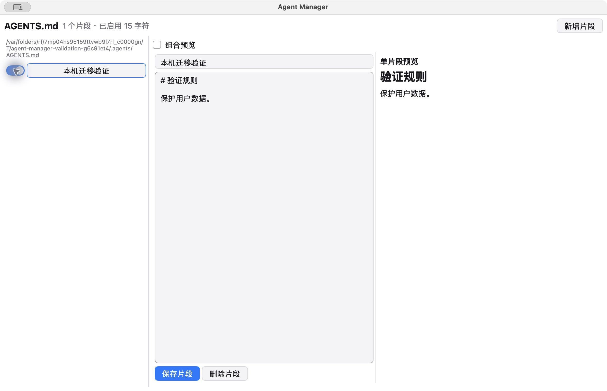

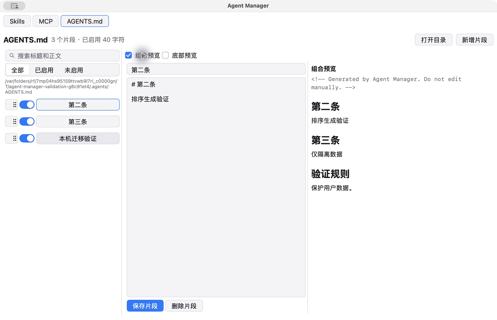

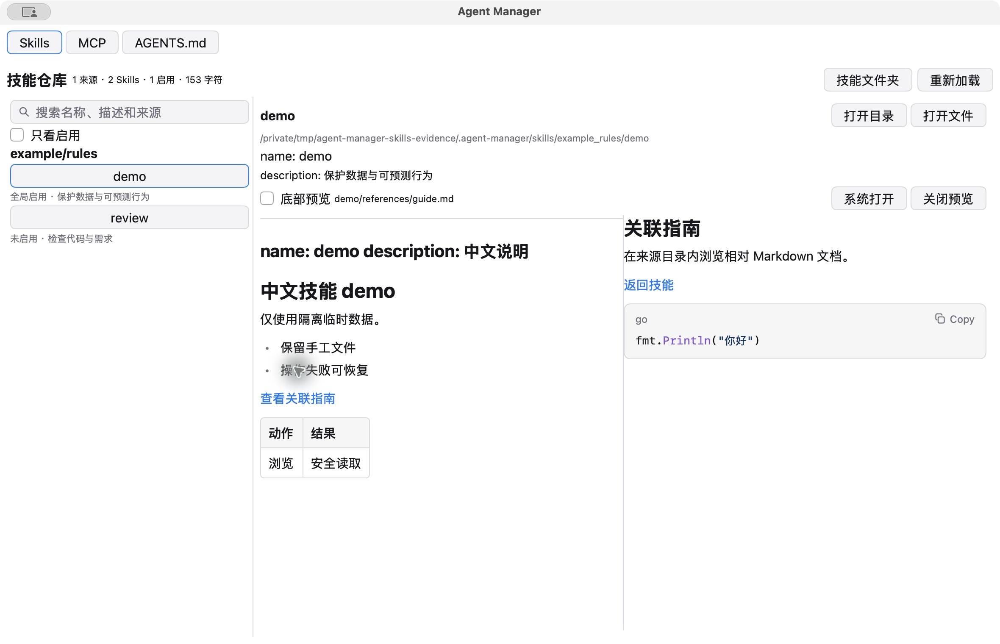

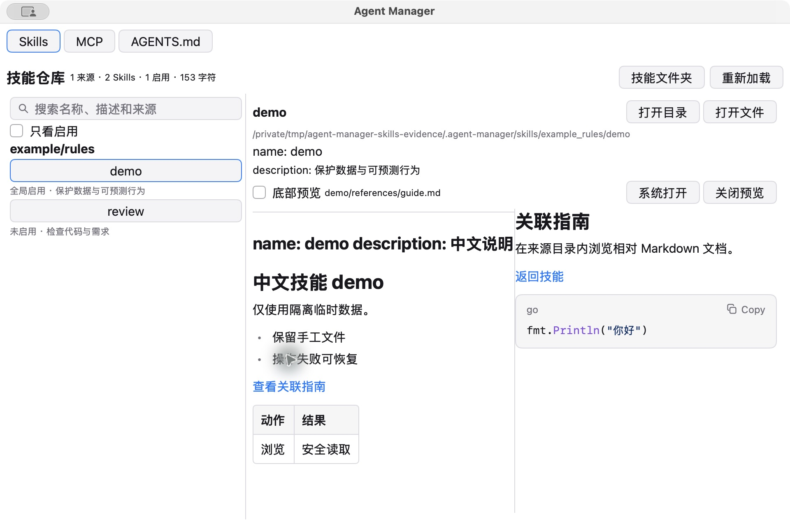

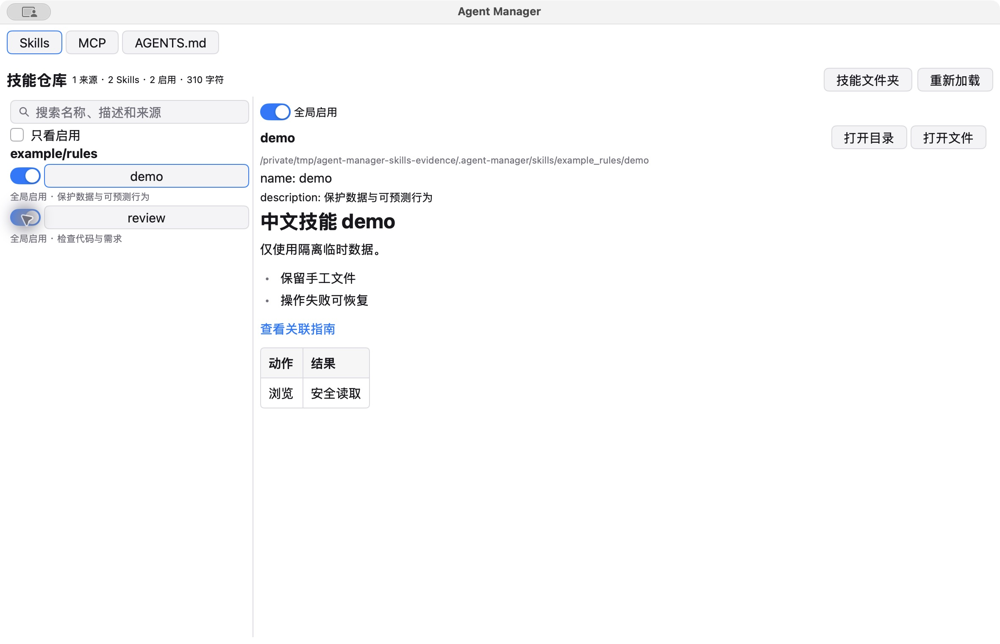

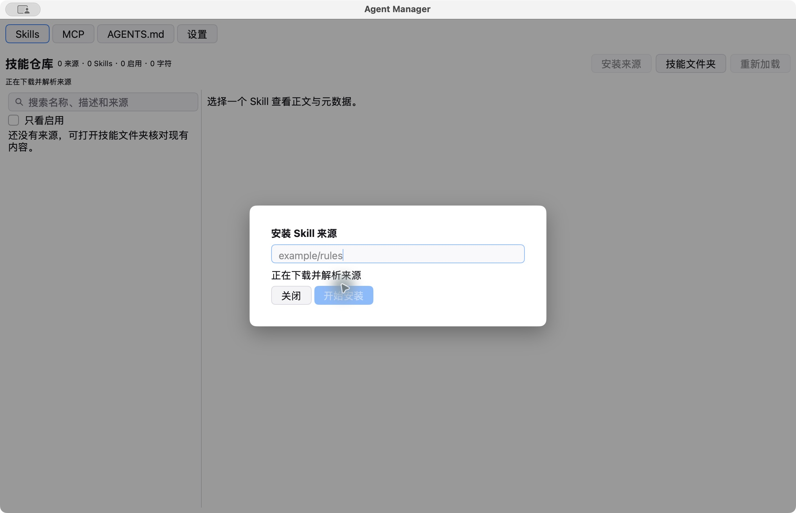

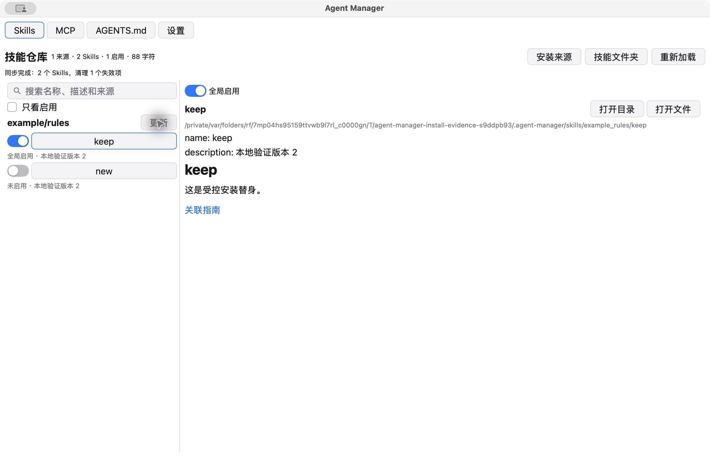

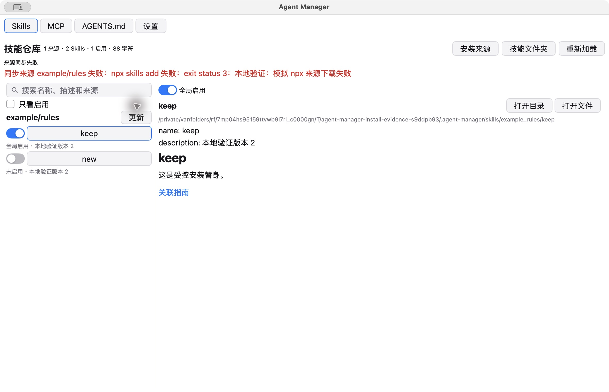

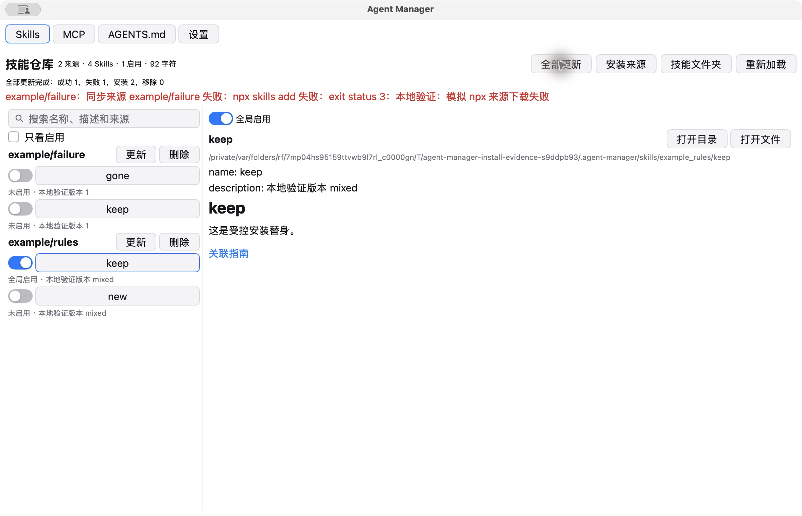

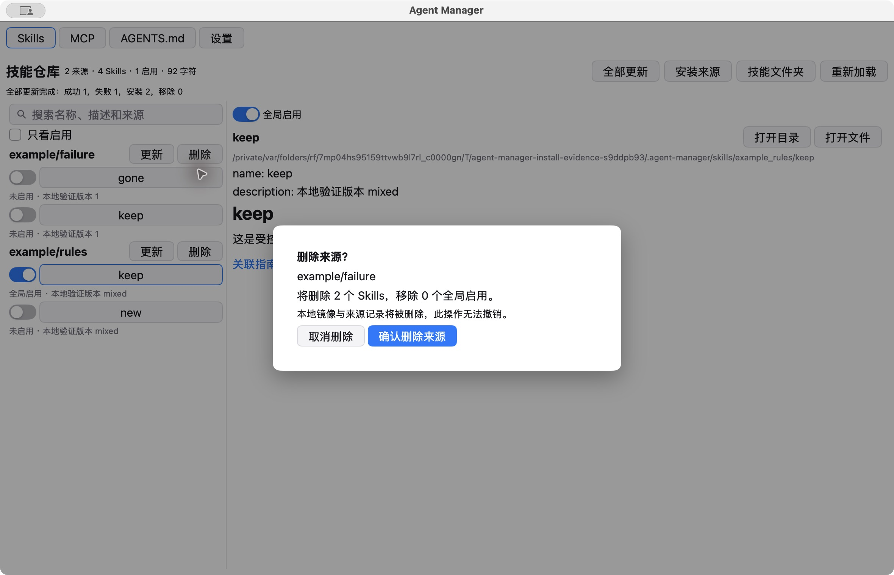

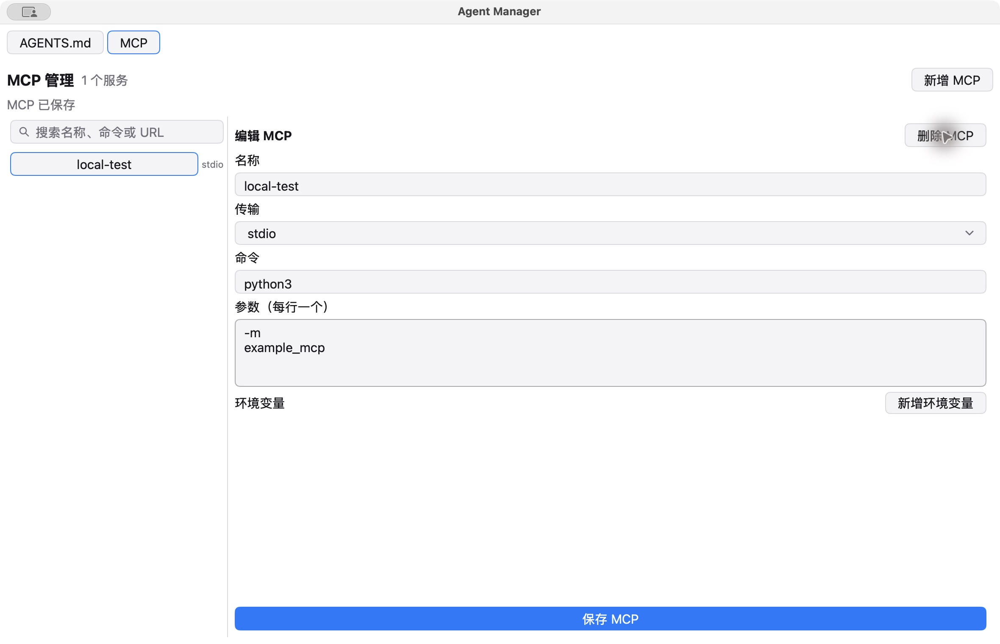

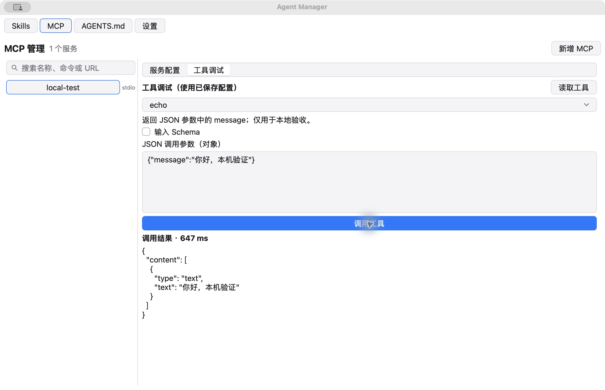

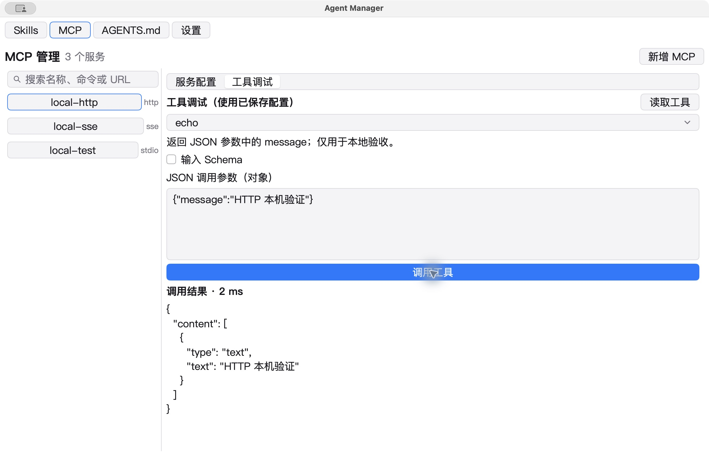

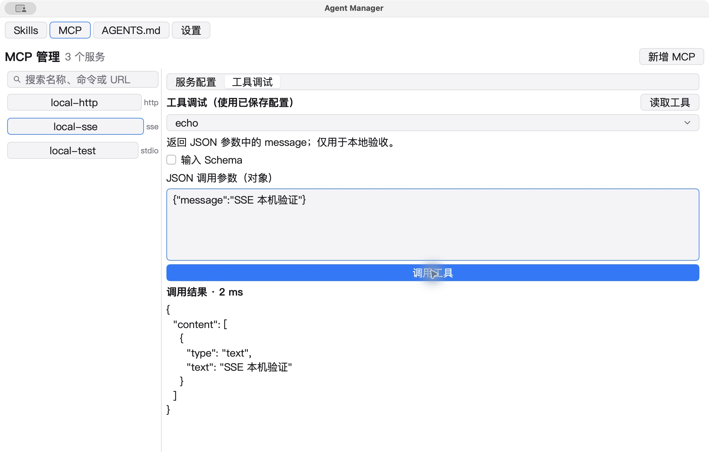

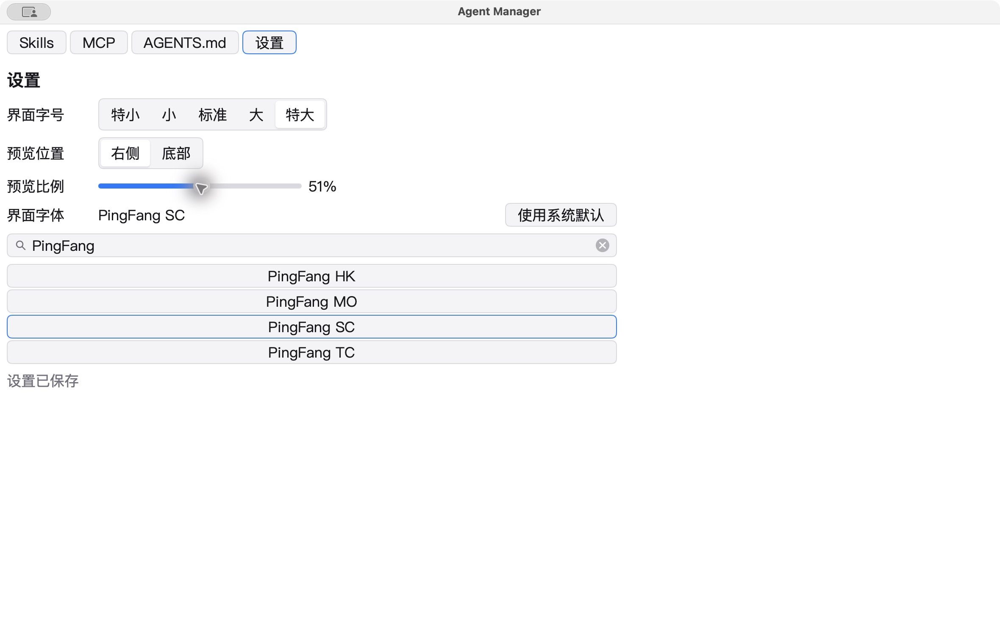

五档默认截图为settings-size-特小/小/标准/大/特大.png；最小窗口截图为settings-minimum-特小/小/标准/大/特大.png。字号13/14/15/16/17，截图为Retina2倍像素，包含系统装饰。以上是各票完成时的窗口证据，正式应用侧栏与最终构建在交付阶段再留存。

## 验证边界

无窗口测试验证公开服务与交互事件；原生窗口验证GPU显示、真实中文输入/系统编辑和操作结果。没有三平台结论；没有旧版与新版同时操作同一数据库的支持承诺。真实环境仅临时数据，保留旧Agents/分发字段但不使用、不探测GAAL、不生成分发配置。最终交付与评审记录将随#13补充。
