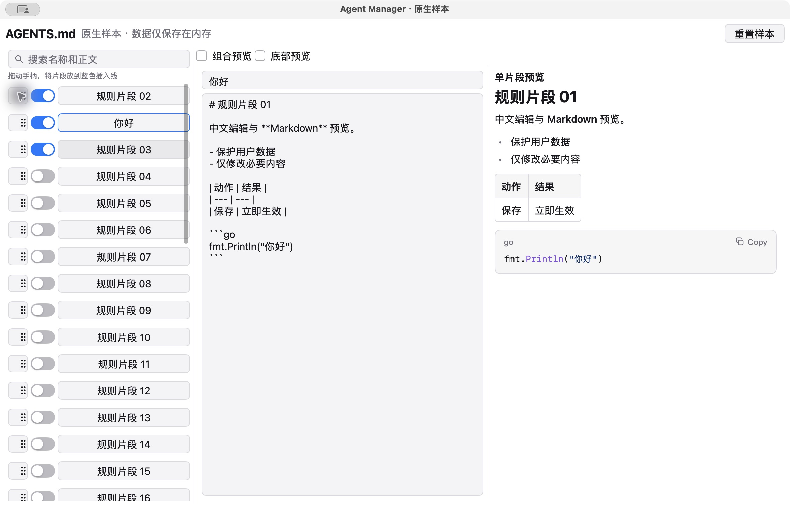
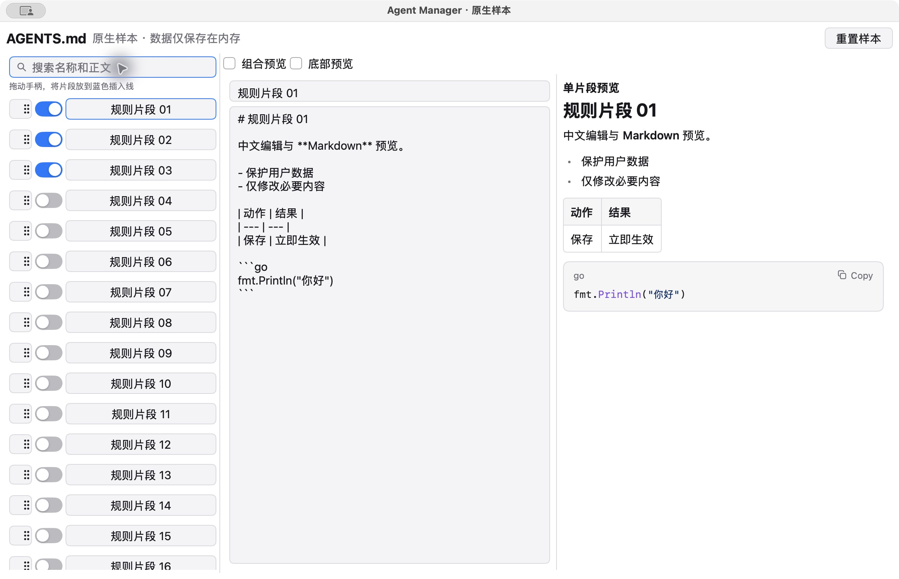
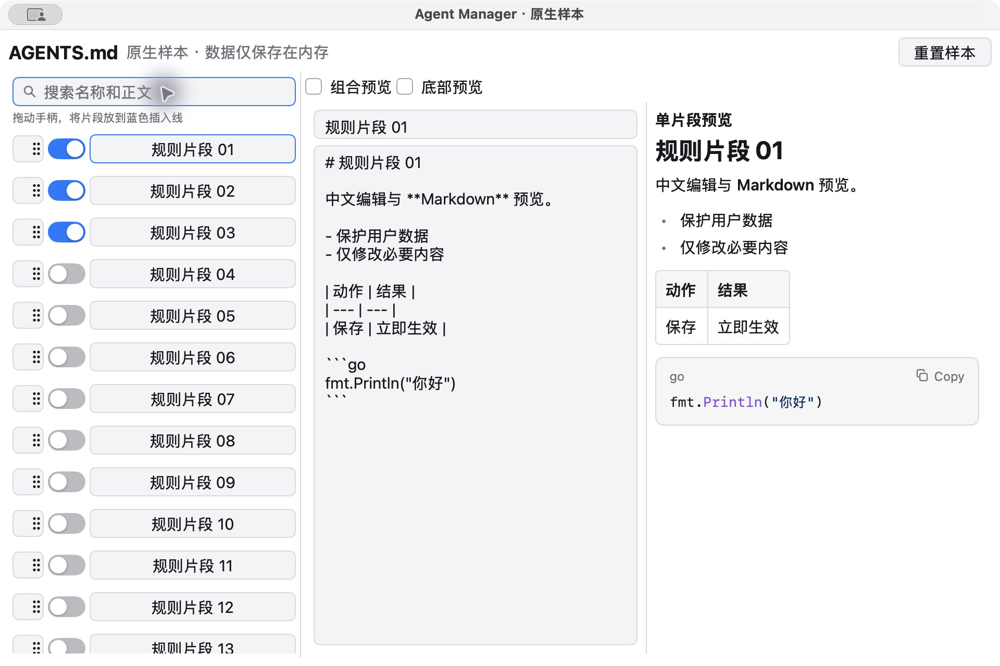
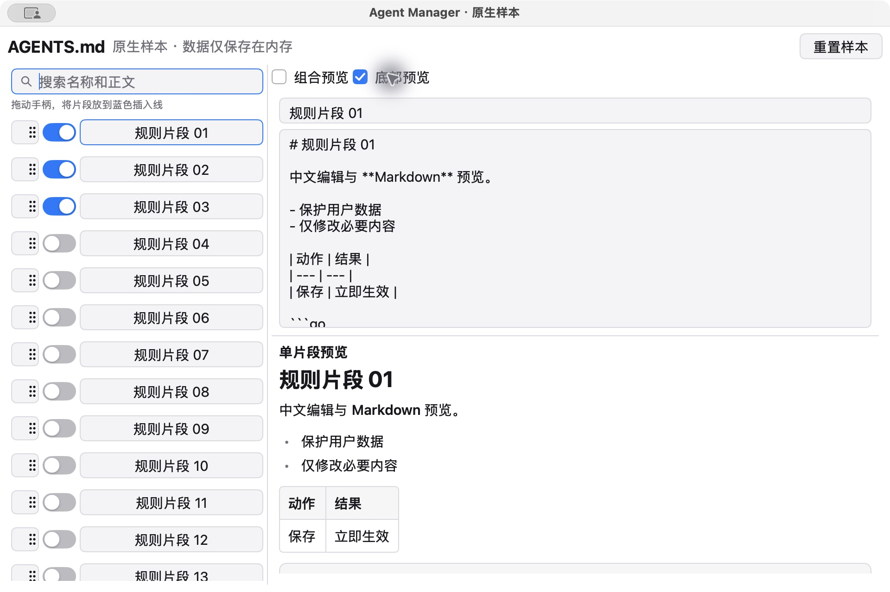

> **2026-10-30 复验结论：按用户修订的 macOS ARM64 范围，样本通过。** 以下“三平台仍阻塞”是前一轮历史结论，已被 ADR-0003 覆盖，不再阻塞后续任务。

本轮在原生窗口通过Ctrl+Space切换中文输入，逐键输入nihao，观察到带下划线的组合文本，Space提交为“你好”；恢复原输入源。选区Cmd+A、Cmd+C、正文Cmd+V、Cmd+Z可用；专用手柄实际拖拽后顺序由1/2/3变为2/1/3；Tab进入开关、Space切换，Escape取消并返回触发按钮、Enter重新打开确认均实测通过。中文提交与排序结果见macos-ime-committed.png。

8个测试通过，其中公开视图测试补验了持握手柄于滚动边缘2秒、后续行可见及释放后的排序，组合输入、复制粘贴/撤销与键盘行为。边缘自动滚动的持续持握由自动化指针事件验证，真实窗口测试覆盖拖放；不将自动化事件写成手工操作。无需框架分支或自定义输入/渲染系统。

---

# #2 验证记录

结论：**尚未通过迁移门槛**。#2保持打开，#3–#13不开始。本记录仅为样本实现和本机部分验证，不代表#1完成。

环境：2026-10-29，macOS15.7.7 (24G720)、arm64，Go1.27.3、MyGo v0.7.3。40个片段全部在内存，无真实用户数据。最终代码e0a7efb（集成提交2c800f6）；原生窗口通过临时.app包装运行，包装只指定样本可执行文件和独立应用身份。

## 已执行

- Go格式、5个测试、vet、build通过。公开视图交互覆盖中文编辑、搜索空反馈、手柄排序、取消弹窗及焦点返回、960×640分栏两端边界；内存操作覆盖组合预览与顺序。
- macOS窗口实际运行：中文粘贴后列表立即变化，Cmd+Z恢复名称；Escape取消重置并保留编辑。焦点未返回按钮的问题先补失败测试，再显式绑定触发按钮修复，原生AX复验确认焦点返回“重置样本”。
- 默认1180×760、最小960×640和最小窗口底部预览截图已检查：常规布局无重叠，搜索框焦点可见，标题、列表、表格和代码块可读，超出内容通过滚动阅读。截图为Retina2倍分辨率，包含窗口装饰。
- 旧链路npm run check/build、cargo fmt --check、cargo test、cargo clippy -- -D warnings全部通过；Rust22通过、2忽略。旧实现未修改。

## 构建反馈

秒数来自monotonic墙钟，原始结果见measurements.json。旧栈是完整应用，Go是小样本；开发构建不含打包/签名，不能推断完整迁移收益。没有清空用户缓存。

| 项目 | 首次观测 | 修改后 |
| --- | ---: | ---: |
| 旧前端npm run build | 8.065 | 14.006 |
| 旧Rust cargo build | 40.029 | 5.262 |
| 原生go build，独立空GOCACHE | 7.018 | 0.575 |

旧栈沿用依赖缓存，首次观测不能称全冷启动。修改后追加注释触发构建，再恢复源文件；测量期间另有cargo测试/Clippy竞争，因此不是受控性能基准。原生测量在临时源码副本1fce387进行，模块缓存已下载，GOCACHE全新，首次包含标准库/框架编译；修改后追加注释、同缓存重建。原生排除依赖下载，不能计算严格加速比。最早依赖安装和测试编译没有完整计时，端到端首次安装反馈仍待补测。

## Standards评审

2项：分栏缺少可读边界；间距3违反2px网格、指示线硬编码颜色。e0a7efb修复为侧栏240–360、预览20%–80%并按窗口收紧，间距4、指示线使用主题Accent。公开指针交互回归检查布局实际尺寸。

## Spec评审

2项：预览比例未限制（与规范发现重复，已修复）；三平台验收证据缺失（仍阻塞）。未发现额外业务迁移。没有修改框架、渲染或输入系统。

## 仍需证据

| 平台 | 原生运行/截图 | 中文输入/系统编辑 | 完整键盘、拖拽/边缘滚动 |
| --- | --- | --- | --- |
| macOS arm64 | 默认/最小/底部已验证 | 粘贴/撤销已验证；真实输入法候选词、组合输入、选区/复制未验证 | Escape/焦点返回已验证；完整Tab/Enter/Space及真实手柄拖拽/自动滚动未验证 |
| Windows | 未验证 | 未验证 | 未验证 |
| Linux | 未验证 | 未验证 | 未验证 |

后续在真实平台运行上一级README入口，记录系统、输入法、动作、结果和截图。交叉编译、无窗口测试或框架文档不能替代证据。当前为未验证，尚无证据要求维护框架分支；出现该需要时按ADR-0001重新评估，不能继续全面迁移。
